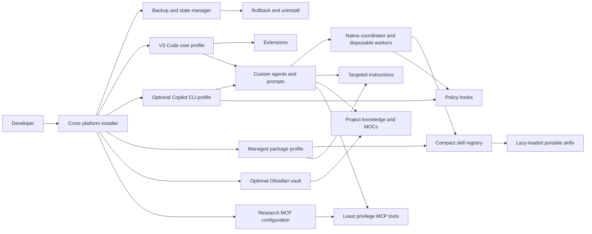
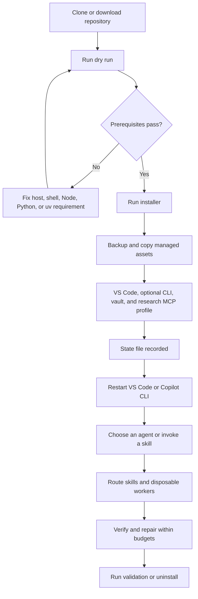
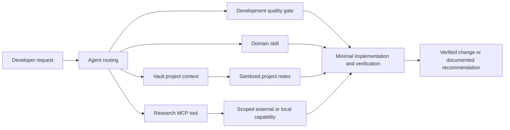
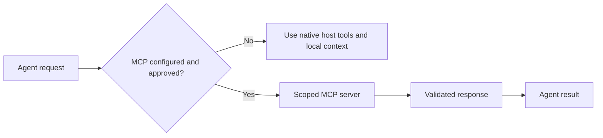

# Assured Arc

> A public, safety first workbench for repeatable GitHub Copilot workflows in VS Code and Copilot CLI, with portable agents, skills, hooks, optional Obsidian knowledge management, and reviewed research MCP tools.

## Short description

**Assured Arc** creates a consistent, auditable agentic development environment across VS Code and GitHub Copilot CLI. Repository agents and skills work in either host automatically. One installer configures the VS Code experience and can optionally add the same agents, skills, instructions, hooks, and reviewed MCP tools to a personal Copilot CLI profile without copying secrets or replacing unrelated configuration.

It is intended for developers, teams, workshops, and maintainers who need the same safe AI-assisted workflow across machines while retaining backup, rollback, customization, and uninstall support.

## At a glance

| Area | Included capability |
| --- | --- |
| Installation | One Windows entry point, cross-platform internal installers, dry run, backup, rollback, repeat install, and uninstall |
| Agents | 7 visible specialists plus 5 hidden disposable workers |
| Hosts | VS Code by default, plus explicit personal-profile installation for GitHub Copilot CLI |
| Orchestration | Native GitHub Copilot coordinator, one writer, depth one, up to 3 concurrent workers, independent verification, and bounded repair |
| Skills and prompts | 27 portable lazy-loaded skills and 6 VS Code reusable prompts |
| MCP research | Context7, Sequential Thinking `2026.7.4`, and isolated arXiv MCP `0.5.1` |
| Knowledge | Optional portable Markdown and Obsidian vault template |
| Safety | Least privilege tool scopes, protected global paths, state integrity, metadata-only traces, public safety checks, and explicit approval boundaries |

## Problem statement

Modern GitHub Copilot workflows depend on custom agents, skills, instructions, hooks, MCP servers, IDE settings, CLI settings, and local knowledge. Configuring these pieces independently creates several recurring problems:

- Machines drift because each component is installed and updated differently.
- Agent prompts grow large because every workflow is loaded instead of selecting relevant skills lazily.
- Broad tool access lets research, implementation, and verification responsibilities overlap.
- Multiple agents can edit concurrently, producing conflicting changes and unclear ownership.
- MCP tools can duplicate native host capabilities or introduce unnecessary file, network, and credential exposure.
- Installers that overwrite user settings or cannot roll back make experimentation risky.
- Personal paths, secrets, internal endpoints, and raw transcripts can accidentally leak into shared configuration.

## Proposed solution

The repository provides a manifest-driven, GitHub Copilot-native agent harness and a reversible installer. It uses portable custom agents, subagents, skills, and hooks rather than adding a second orchestration framework or background service. VS Code prompt files remain an IDE-specific convenience.

The solution follows this execution model:

1. Convert the user request into explicit acceptance criteria and stopping conditions.
2. Select no more than three relevant skills from compact registries.
3. Complete simple work directly or delegate focused tasks to disposable workers.
4. Allow only one implementation writer and keep remote research separate from editing.
5. Run independent verification and permit at most two evidence-driven repairs.
6. Return one consolidated result with evidence and remaining uncertainty.
7. Record package ownership so upgrades and uninstall affect only package-managed assets.

This repository provides a manifest driven setup with safe defaults:

- Copies generic, public safe AI agents, skills, and instructions into supported VS Code and optional Copilot CLI locations.
- Backs up affected VS Code and Copilot CLI configuration before changing it.
- Merges missing settings rather than replacing user settings by default.
- Installs recommended extensions through VS Code unless explicitly skipped.
- Creates an optional Markdown first Obsidian vault template.
- Installs the reviewed Context7, Sequential Thinking, and arXiv MCP profile by default, with an explicit opt out.
- Records installation state for rollback and uninstall.
- Installs a bounded native agent harness with disposable subagents, one writer, independent verification, and metadata only local traces.

> [!warning]
> This is a starter kit, not a copy of anyone’s personal configuration. Do not commit credentials, customer data, internal URLs, private vault content, raw chat transcripts, or organization specific MCP endpoints.

## Capabilities

| Capability | What it provides | Key boundary |
| --- | --- | --- |
| Safe installation | Merged settings, optional extensions and vault, state checksum, backups, rollback, and uninstall | Existing unrelated settings and MCP entries are preserved |
| Native orchestration | Coordinator plus Scout, Researcher, Implementer, Verifier, and Critic workers | Delegation depth one, one active writer, and no nested workers |
| Context-efficient skills | Compact registry selects up to three skills, with Development Quality added for code changes | The full skill library is not injected into every prompt |
| Independent quality gates | Focused verification, regression checks, critic reviews, and bounded repairs | Verification remains separate from the writer |
| Research tooling | Current library docs, structured analysis, and academic paper research | MCP tools are available to researchers, not the implementation worker |
| Policy hooks | Worker and tool budgets, protected paths, approval checks, and local traces | Traces exclude prompts, reasoning, contents, arguments, results, and secrets |
| Durable project context | Optional Markdown and Obsidian vault with MOCs and project templates | Private artifacts stay under `local-only/` |
| Public package safety | Generic examples, secret-free templates, and automated scans | No tenant data, personal paths, internal URLs, or private MCP endpoints |

## Architecture

[](docs/assets/assured-arc-architecture.svg)

The animation progressively reveals the host surfaces, acceptance contract, bounded execution loop, disposable workers, context sources, and verification boundary. Open the [editable static SVG](docs/assets/assured-arc-architecture.svg) for a motion-free version. The Mermaid diagrams below remain the structural reference. See [Graph and Agent Alignment](docs/GRAPH_ALIGNMENT.md) for the arXiv paper comparison, the Agent-Graph assessment, and the decision not to add a second orchestration runtime by default.



### Installation to daily usage

[](docs/assets/assured-arc-installation-flow.svg)



### Agent context and data flow



## Quick start

### Prerequisites

| Platform | Required for the default installation |
| --- | --- |
| Windows | VS Code, PowerShell, Node.js 18 or newer with `npx`, `uv`, and Python 3.11 or newer |
| macOS or Linux | VS Code, Bash, Python 3, Node.js 18 or newer with `npx`, and `uv` with Python 3.11 or newer |

The VS Code `code` command is required only when extension installation is enabled. Obsidian is optional because the generated vault remains standard Markdown.

Clone the repository, inspect the dry run, then run the installer.

### Windows

```powershell
git clone https://github.com/4R9UN/assured-arc.git
Set-Location assured-arc
.\install.ps1 -DryRun
.\install.ps1
.\install.ps1 -InstallCopilotCli
```

### macOS and Linux

```bash
git clone https://github.com/4R9UN/assured-arc.git
cd assured-arc
bash install/assured-arc.sh --dry-run
bash install/assured-arc.sh
bash install/assured-arc.sh --install-copilot-cli
```

The default install creates `~/.assured-arc` for state, backups, managed skills, hooks, arXiv runtime, and the optional vault. `-InstallCopilotCli` or `--install-copilot-cli` additionally uses the native Copilot home, normally `~/.copilot`, for agents, instructions, user hooks, settings registration, and CLI MCP configuration. Existing VS Code and CLI settings and unrelated MCP entries are merged, not replaced.

### Confirm installation

After installation, restart or reload the selected hosts, then verify:

1. **Assured Arc Orchestrator** appears in the agent picker.
2. The six package prompts appear in the slash-command menu.
3. Context7, Sequential Thinking, and arXiv appear under **MCP: List Servers**.
4. The state file exists under `~/.assured-arc/state.json`.
5. Chat customization diagnostics show no errors for package agents, prompts, skills, or hooks.

For Copilot CLI integration, also verify:

1. Run `copilot --agent assured-arc-orchestrator` or select the agent with `/agent`.
2. Run `copilot skill list` and confirm the packaged skills are listed from the managed directory.
3. Run `copilot mcp list` and confirm Context7, Sequential Thinking, and arXiv when MCP installation is enabled.
4. Restart Copilot CLI after hook or agent changes because those files load at session start.

## Installation options

| Need | PowerShell | Bash |
| --- | --- | --- |
| Preview all work | `-DryRun` | `--dry-run` |
| Install into the personal Copilot CLI profile | `-InstallCopilotCli` | `--install-copilot-cli` |
| Skip extensions | `-SkipExtensions` | `--skip-extensions` |
| Skip vault | `-SkipVault` | `--skip-vault` |
| Choose vault path | `-VaultPath <path>` | `--vault-path <path>` |
| Skip the default three-server MCP profile | `-SkipMcp` | `--skip-mcp` |
| Replace conflicting settings | `-ForceSettings` | `--force-settings` |
| Disable backups | `-NoBackup` | `--no-backup` |

Copy [config/assured-arc.example.json](config/assured-arc.example.json) to a local, ignored location when you need repeatable customization. Do not store secrets in that file.

## Included AI agents

| Agent | Purpose | Typical use |
| --- | --- | --- |
| Assured Arc Orchestrator | Global coordinator with read, search, and subagent capabilities | Contract, route skills, delegate, verify, and synthesize |
| Assured Arc Development | Minimal, testable implementation work | Add a feature, fix a bug, refactor a focused component |
| Assured Arc Architecture | Minimum viable architecture and tradeoff analysis | Design boundaries, APIs, data flow, or major refactors |
| Assured Arc QA | Reproduction, test design, regression, and lifecycle validation | Validate bugs, implementations, installers, and rollback |
| Assured Arc Documentation | Accurate documentation and Mermaid diagrams | Update onboarding, architecture, examples, or guides |
| Assured Arc Research | Read only public dependency evaluation | Assess a VS Code extension, MCP server, or community skill |
| Assured Arc Security Review | Read only installation and configuration review | Review secrets, permissions, MCP scope, rollback, and release readiness |

Each agent has a dedicated [configuration file](.github/agents) with a clear purpose, cross-host tool aliases, interaction model, and safety boundary. Repository copies are discovered by both hosts. With personal CLI installation enabled, agents are copied to the CLI-native agent directory and VS Code points to the same source to avoid duplicate user-level definitions.

The orchestrator can instantiate five hidden disposable worker archetypes: Scout, Researcher, Implementer, Verifier, and Critic. Workers have isolated context, cannot spawn children, and terminate after returning one focused result. Only the Implementer can edit. See [docs/HARNESS.md](docs/HARNESS.md).

## Included reusable prompts

The package installs six short, user-invoked prompt files into its managed VS Code prompt directory. Copilot CLI does not consume `.prompt.md` files; invoke the corresponding agent or skill directly instead.

| Prompt | Purpose |
| --- | --- |
| `plan-implement-verify` | Route, implement, and validate a development request end to end |
| `research-and-decide` | Evaluate a dependency, technology, MCP server, extension, or architecture choice |
| `review-current-change` | Review the current diff for correctness, security, rollback, tests, and unnecessary complexity |
| `parallel-research-synthesize` | Run up to three independent read only evidence streams and synthesize one answer |
| `multi-agent-change-review` | Review a change through independent correctness, security, and reliability perspectives |
| `evolve-harness-safely` | Draft and evaluate an isolated harness change without global promotion |

Prompts reference packaged agents instead of duplicating their full policies. A concise general instruction applies evidence-first behavior, safe action boundaries, and focused verification to all packaged agents.

## Included skills

The package includes **27 curated skills**. The installed [skill registry](config/skill-registry.json) routes each request to no more than three domain skills. Code-changing tasks always add the Development Quality gate.

| Category | Skills | Why it matters |
| --- | --- | --- |
| Core | Skill Router, Development Quality, Repository Onboarding, Task Planning, Agent Orchestration, Context Efficiency | Select focused context, coordinate bounded workers, and reduce repeated tokens |
| Design | Architecture Design | Resolve boundaries and tradeoffs before expensive implementation |
| Implementation | Backend and API, Frontend and Accessibility, Python Quality, Data and SQL, Configuration Management | Apply stack-aware implementation guidance only when relevant |
| Quality | Debugging, Testing, Code Review, Performance and Reliability, Security and Privacy, Error Handling, Observability, Agent Evaluation, Ponytail | Find root causes, verify behavior, test loops, reduce defects, and remove unnecessary complexity |
| Delivery | Git and CI, Dependency Evaluation, Documentation Quality | Improve integration, supply-chain decisions, and developer onboarding |
| Platform | MCP Safety, Obsidian Vault, Harness Evolution | Add live tools, durable knowledge, and review gated agent improvement |

Skills are lazy loaded by their descriptions and the registry. This keeps context focused instead of loading every workflow into each chat. See [docs/SKILLS.md](docs/SKILLS.md) for every skill’s capability, prerequisites, practical use, and productivity benefit.

Customize agents, skills, extension manifests, vault templates, and MCP templates through [docs/CUSTOMIZATION.md](docs/CUSTOMIZATION.md).

## Obsidian vault integration

The optional [vault template](vault-template) is standard Markdown. It works without Obsidian, but becomes more navigable when opened in Obsidian.

```text
vault/
├── Home.md
├── MOCs/
│   ├── Projects.md
│   ├── Engineering.md
│   ├── Agents and Skills.md
│   └── MCP Tools.md
├── _templates/
│   └── Project Template.md
└── local-only/
    └── .gitkeep
```

- `Home.md` is the entry point.
- MOCs organize project, engineering, agent, skill, and MCP context.
- The project template records outcomes, validation, agents, skills, and MCP tools.
- `local-only/` is excluded from version control for screenshots, raw logs, secrets, and private artifacts.

See [docs/OBSIDIAN.md](docs/OBSIDIAN.md) for workflows and VS Code integration.

## MCP tools

The default VS Code [MCP template](mcp/mcp.json.example) and [Copilot CLI template](mcp/copilot-cli.mcp.json.example) contain the same three research tools with host-native top-level keys:

| Tool | Purpose | Boundary |
| --- | --- | --- |
| Context7 | Current, version-specific library and API documentation | Hosted HTTPS, requests leave the machine |
| Sequential Thinking | Structured analysis with revision and branching | Pinned npm package, thought logging disabled |
| arXiv | Academic paper search, download, and reading | Isolated `uv` tool, downloaded papers stored locally and treated as untrusted |

Native VS Code and Copilot CLI tools handle local files, shell work, and GitHub access, so duplicate MCP servers are intentionally excluded. Ponytail remains a lazy-loaded YAGNI skill rather than a second runtime.



### MCP configuration principles

- Use local `stdio` for development and narrowly scoped file access.
- Use HTTPS for remote endpoints.
- Store tokens in environment variables or host secret stores, never in committed JSON.
- Review every community MCP server before enabling it.
- Keep a rollback path through the Assured Arc installation state file.

The profile requires Node.js 18 or newer with `npx`, plus `uv` and Python 3.11 or newer. Context7 and package installation require network access. The installer pins Sequential Thinking and installs arXiv into the package-managed profile.

See [docs/MCP.md](docs/MCP.md) for protocols, authentication patterns, endpoints, and troubleshooting.

## What the installer changes

| Location | Change | Default behavior |
| --- | --- | --- |
| VS Code user settings | Adds missing AI instruction discovery settings | Backs up, then merges defaults |
| Managed customization root | Adds agents, prompts, skills, instructions, harness policy, and hooks under `<profile-root>/copilot` | Does not overwrite existing personal skill or prompt libraries |
| VS Code customization locations | Adds exact managed agent, prompt, skill, instruction, and hook paths | Removes only package paths on uninstall |
| Copilot CLI personal profile | Optionally adds agents, modular instructions, a managed skill-directory entry, user hooks, and reviewed MCP entries | Explicit opt in, conflict checked, and removed by exact ownership |
| Local harness traces | Writes size limited metadata under `<profile-root>/harness-runs` | Excludes prompts, content, arguments, results, and secrets |
| Extensions | Recognizes built-in Copilot Chat and installs missing manifest extensions without forcing replacement or downgrade | Enabled unless skipped |
| MCP user config | Adds three reviewed research servers and a managed arXiv runtime | Enabled unless skipped |
| Vault path | Creates missing template files | Enabled unless skipped |

## Usage examples

### Example: implement and verify a feature

Select **Assured Arc Orchestrator** or invoke `/plan-implement-verify`, then ask:

> Add validation for this configuration field, preserve backward compatibility, and add a regression test.

The harness inspects the repository, selects relevant skills, assigns one writer, runs an independent verifier, and returns changed files plus validation evidence.

### Example: research a current library API

Select **Assured Arc Research** or invoke `/research-and-decide`, then ask:

> Verify the current authentication API for this framework and recommend the smallest supported integration.

The research agent uses Context7 for current documentation, separates verified facts from assumptions, and does not edit or install the evaluated dependency.

### Example: research academic papers

Ask **Assured Arc Research**:

> Find recent arXiv papers about agent evaluation, compare their methodologies, and identify practical ideas for this harness.

The agent uses arXiv for paper discovery and treats downloaded paper text as untrusted external data.

### Example: analyze a complex design

Select **Assured Arc Orchestrator** and ask:

> Compare two deployment designs, identify trust and failure boundaries, select the minimum viable option, and define verification checkpoints.

The coordinator can use Sequential Thinking for revision and branching, parallel read-only workers for independent evidence, and a critic for unsupported assumptions.

### Example: review a change from several perspectives

Invoke `/multi-agent-change-review`:

> Review the current change for correctness, security, rollback safety, and unnecessary complexity.

Independent critics inspect distinct dimensions, then the coordinator deduplicates findings by root cause and severity.

### Example: use the simplest solution

Ask for the Ponytail skill explicitly:

> Use Ponytail mode to simplify this implementation and identify what can be deleted.

The skill prefers deletion, standard libraries, platform capabilities, and direct code over speculative abstractions.

### Example: install without optional components

```powershell
.\install.ps1 -SkipExtensions -SkipVault -SkipMcp
```

This installs only the VS Code-managed agents, prompts, skills, instructions, harness policy, and hooks. Add `-InstallCopilotCli` when the same pack should also be globally available in Copilot CLI.

## Real world scenarios

### Scenario: new laptop onboarding

A developer installs VS Code and runs the dry run. The installer finds the `code` command, shows the extension plan, backs up existing settings, adds agents and skills, and creates a vault at `~/.assured-arc/vault`.

### Scenario: team project knowledge

A team copies the vault template into a project repository. Each project note records ownership, success criteria, selected skills, and validation evidence. Private logs remain in `local-only/`.

### Scenario: safe MCP evaluation

A developer uses Assured Arc Research to examine a public MCP server. Assured Arc Security Review checks transport, authentication, scope, and data exposure before any capability beyond the reviewed baseline is added.

### Scenario: rollback after a bad setup

The installer state file records managed paths and backups. Run the uninstall script to remove package assets. Add `-RestoreBackups` or `--restore-backups` to restore the saved user configuration.

## Uninstall and rollback

If this machine has a profile created before the Assured Arc rebrand, uninstall that profile before installing Assured Arc. Run the uninstall script from the matching installed version, or pass the exact prior profile root explicitly. Do not copy or move its state file into `~/.assured-arc`.

### Uninstall on Windows

```powershell
pwsh -File install/uninstall.ps1 -DryRun
pwsh -File install/uninstall.ps1
pwsh -File install/uninstall.ps1 -RestoreBackups -RemoveExtensions -RemoveVault
```

### Uninstall on macOS and Linux

```bash
bash install/uninstall.sh --dry-run
bash install/uninstall.sh
bash install/uninstall.sh --restore-backups --remove-extensions --remove-vault
```

By default, uninstall removes managed agents, skills, prompts, instructions, hooks, package-owned VS Code and Copilot CLI MCP entries, and the managed arXiv runtime. Existing host settings and unrelated MCP entries remain untouched. Backup restoration returns complete pre-install files when explicitly requested.

## Validation

```powershell
pwsh -File tests/validate.ps1
```

```bash
bash tests/validate.sh
```

Validation checks file structure, JSON, script syntax, harness capability contracts, hook budgets and redaction, the root installer, skill and prompt metadata, registry parity, installer lifecycle, rollback, settings cleanup, vault behavior, the exact three-server MCP inventory, and a no-network MCP fixture lifecycle.

## Troubleshooting

| Problem | Resolution |
| --- | --- |
| `code` command missing | Open VS Code Command Palette, run **Shell Command: Install 'code' command in PATH**, then restart the terminal. Or use `-SkipExtensions`. |
| PowerShell execution policy blocks scripts | Run with `pwsh -ExecutionPolicy Bypass -File .\install.ps1`. Review the script before using bypass. |
| Python 3 missing on macOS or Linux | Install Python 3, which the Bash installer uses only for safe JSON merge and state generation. |
| Copilot CLI agent is missing | Restart the CLI, then use `/agent` or `copilot --agent assured-arc-orchestrator`. Confirm `-InstallCopilotCli` was used for personal availability. |
| MCP profile does not start | Confirm Node.js 18+, `npx`, `uv`, and Python 3.11+, then inspect `MCP: List Servers` or `copilot mcp list`. |
| Existing settings look wrong | Run uninstall with backup restoration or manually restore a file from `<profile-root>/backups`. |
| Obsidian is not installed | The vault remains usable as Markdown. Install Obsidian later and open the generated vault folder. |

See [docs/TROUBLESHOOTING.md](docs/TROUBLESHOOTING.md) for detailed diagnostics.

## Repository layout

```text
.
├── install.ps1                # Single Windows installation entry point
├── .github/
│   ├── agents/                 # Portable VS Code and Copilot CLI agents
│   ├── instructions/           # Targeted AI instructions
│   ├── prompts/                # Reusable slash-command prompt files
│   ├── hooks/                  # Portable hook configuration template
│   └── skills/                 # Lazy loaded reusable workflows
├── config/                     # Extension, settings, and Assured Arc manifests
├── docs/                       # Tutorials and component reference
├── hooks/                      # Cross platform policy and trace hook scripts
├── install/                    # Internal platform lifecycle implementations
├── mcp/                        # Safe MCP templates and schemas
├── tests/                      # Static and dry run validation
└── vault-template/             # Portable Obsidian compatible Markdown vault
```

## Security model

This package is safe by default, not magical.

- Review every extension and MCP server before enabling it.
- Use the dry run on a new machine.
- Keep secret values outside tracked configuration.
- Treat downloaded skills and MCP config as code that requires review.
- Use the provided security review agent before public release or team wide rollout.
- Do not assume the installer can validate a cloud upload, remote MCP endpoint, or third party extension’s runtime behavior.

See [SECURITY.md](SECURITY.md) for reporting and hardening guidance.

## Contributing

Contributions are welcome. Read [CONTRIBUTING.md](CONTRIBUTING.md) before opening an issue or pull request.
All contributors are expected to follow the [Code of Conduct](CODE_OF_CONDUCT.md).

Contributors should:

1. Keep changes public safe and portable.
2. Add tests or validations for installer and config changes.
3. Preserve idempotency, backup, rollback, and dry run behavior.
4. Avoid adding a dependency when standard platform functionality is sufficient.
5. Update documentation and diagrams when architecture changes.

## License

This project is released under the [MIT License](LICENSE).

See [NOTICE.md](NOTICE.md) for source attribution and public package boundaries.
