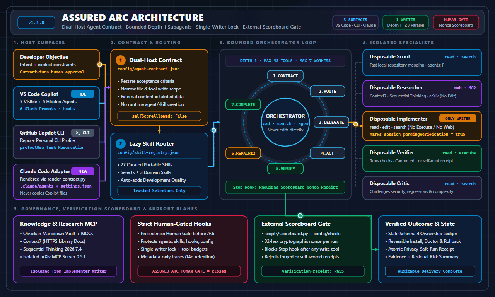

# Assured Arc

> A public, safety-first workbench for repeatable GitHub Copilot workflows in VS Code and Copilot CLI.

## Introduction

Assured Arc packages portable agents, skills, prompts, policy hooks, optional research tools, and reversible installers into one consistent development environment. It uses native GitHub Copilot capabilities rather than adding another orchestration framework.

## Problem statement

Agent configurations often drift across machines, mix research with editing, overwrite user settings, or retain more session data than intended. Assured Arc packages a small native agent harness, reversible installers, focused skills, optional research MCP tools, and an optional Markdown vault without adding another orchestration framework.

This makes agent behavior harder to predict, review, reproduce, and safely remove.

## Proposed solution

Assured Arc provides one auditable setup with specialized agents, lazy-loaded skills, one implementation writer, independent verification, bounded repair, explicit approvals, backup, rollback, and uninstall support. Existing unrelated settings and MCP entries are preserved.

[](docs/assets/assured-arc-architecture.svg)

## How it works

1. Convert the request into explicit acceptance criteria and stopping conditions.
2. Load no more than three relevant skills.
3. Complete simple work directly or delegate focused work to disposable specialists.
4. Allow only one implementation writer while research and verification remain separate.
5. Verify the result independently and allow at most two evidence-driven repairs.
6. Return one result with validation evidence and remaining uncertainty.

## Why it works well

- Native VS Code and Copilot CLI customization keeps the runtime small and portable.
- Narrow agent roles reduce accidental permission overlap.
- Deterministic hooks enforce worker, tool, approval, and protected-path policies.
- Lazy skill loading keeps context focused.
- Offline evaluation fixtures catch policy and lifecycle regressions.
- Exact ownership records make repeat installation and uninstall predictable.

## Capabilities

| Area | Included |
| --- | --- |
| Agents | 7 visible specialists and 5 hidden disposable workers |
| Harness | Depth one, up to 3 parallel workers, one writer, deterministic policy hooks |
| Skills | Compact routing to at most 3 relevant skills |
| Installation | Profiles, dry run, merge-safe settings, backup, rollback, and uninstall |
| Research | Optional Context7, Sequential Thinking, and arXiv MCP profile |
| Knowledge | Optional Markdown-first Obsidian vault template |
| Privacy | Metadata-only traces and allowlisted terminal run receipts |

## Prerequisites

| Component | Needed when |
| --- | --- |
| VS Code and the `code` command | Extension installation is enabled |
| PowerShell | Installing or checking on Windows |
| Bash and Python 3 | Installing or checking on macOS or Linux |
| Node.js 18+, `npx`, `uv`, and Python 3.11+ | MCP installation is enabled |
| GitHub Copilot CLI | Personal CLI installation is enabled |

Obsidian is optional because the vault is standard Markdown.

## Quick start

Clone or download the repository, inspect a dry run, then install.

### Windows

```powershell
git clone https://github.com/4R9UN/assured-arc.git
Set-Location assured-arc
.\install.ps1 -DryRun
.\install.ps1
```

### macOS and Linux

```bash
git clone https://github.com/4R9UN/assured-arc.git
cd assured-arc
bash install/assured-arc.sh --dry-run
bash install/assured-arc.sh
```

Existing unrelated settings and MCP entries are preserved. The default managed root is `~/.assured-arc`.

## Install profiles

| Profile | Extensions | MCP | Vault | Personal CLI |
| --- | --- | --- | --- | --- |
| `Minimal` | No | No | No | No |
| `Research` | No | Yes | No | No |
| `Full` | Yes | Yes | Yes | No |
| `CopilotCli` | No | Yes | No | Yes |

`Full` is the default and preserves the original installation behavior.

```powershell
.\install.ps1 -Profile Minimal
```

```bash
bash install/assured-arc.sh --profile Research
```

Explicit component switches override the profile. Explicit booleans in a supplied configuration file override its selected profile. See [Installation Guide](docs/INSTALLATION.md) for precedence and isolated examples.

## Usage examples

### Implement and verify a change

Select **Assured Arc Orchestrator** or run `/plan-implement-verify`:

> Add validation for this configuration field, preserve compatibility, and add a regression test.

### Research a dependency

Select **Assured Arc Research** or run `/research-and-decide`:

> Compare the current supported options, verify first-party documentation, and recommend the smallest safe choice.

### Review a change

Run `/multi-agent-change-review`:

> Review the current change for correctness, security, rollback safety, and unnecessary complexity.

See [Usage Examples](docs/EXAMPLES.md) for additional workflows.

## Doctor

Doctor is read-only. It checks prerequisites, optional installation state and checksum, managed files, and recorded MCP runtime without repairing or printing personal paths.

```powershell
pwsh -File install/doctor.ps1
```

```bash
bash install/doctor.sh
```

It exits `0` when checks are healthy and `1` when a required check fails. Before installation, absent state is reported separately from prerequisite health.

## Legacy migration planner

The planner validates a legacy state file and reports a sanitized, non-mutating migration plan.

```powershell
pwsh -File install/migrate-legacy.ps1
```

```bash
bash install/migrate-legacy.sh
```

It never runs uninstall or install. Review its output, then run the displayed commands manually. Details are in the [Installation Guide](docs/INSTALLATION.md).

## Safety model

- Public examples contain no credentials, tenant data, private endpoints, or personal paths.
- Installed global agent and harness paths are protected during daily runs.
- Dependency changes, publishing, destructive actions, and global configuration require approval.
- Research workers cannot edit, and the implementation worker cannot use web or MCP tools.
- Traces exclude prompts, reasoning, file contents, tool arguments, results, and raw transcripts.
- Install state records exact ownership for repeat install and uninstall.

Review [Security](SECURITY.md), [Harness](docs/HARNESS.md), and [MCP](docs/MCP.md) before team-wide use.

## Validation

Validation is offline and uses temporary profiles and local MCP fixtures.

```powershell
pwsh -File tests/validate.ps1
pwsh -File tests/public-safety.ps1
```

```bash
bash tests/validate.sh
```

See [tests/README.md](tests/README.md) for covered contracts.

## Uninstall

Preview removal first. Only package-owned assets and discovery entries are removed.

```powershell
pwsh -File install/uninstall.ps1 -DryRun
pwsh -File install/uninstall.ps1
```

```bash
bash install/uninstall.sh --dry-run
bash install/uninstall.sh
```

Backup restoration and optional vault or extension removal require explicit flags. See [Installation Guide](docs/INSTALLATION.md).

## Documentation

| Topic | Guide |
| --- | --- |
| Installation and lifecycle | [Installation](docs/INSTALLATION.md) |
| Agents and handoffs | [Agents](docs/AGENTS.md) |
| Harness policy and receipts | [Harness](docs/HARNESS.md) |
| Architecture | [Architecture](docs/ARCHITECTURE.md) |
| Skills | [Skills](docs/SKILLS.md) |
| MCP tools | [MCP](docs/MCP.md) |
| Vault | [Obsidian](docs/OBSIDIAN.md) |
| Customization | [Customization](docs/CUSTOMIZATION.md) |
| Troubleshooting | [Troubleshooting](docs/TROUBLESHOOTING.md) |

## Contributing and license

Read [Contributing](CONTRIBUTING.md), [Code of Conduct](CODE_OF_CONDUCT.md), and [Release Checklist](docs/RELEASE_CHECKLIST.md) before proposing a change.

Assured Arc is released under the [MIT License](LICENSE). See [NOTICE](NOTICE.md) for attribution and package boundaries.
