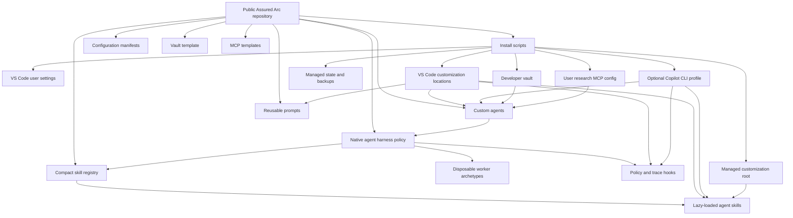
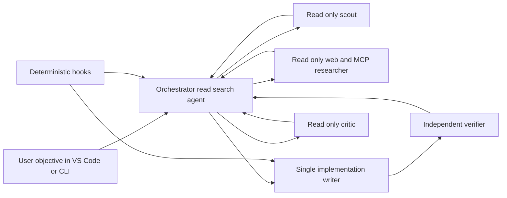
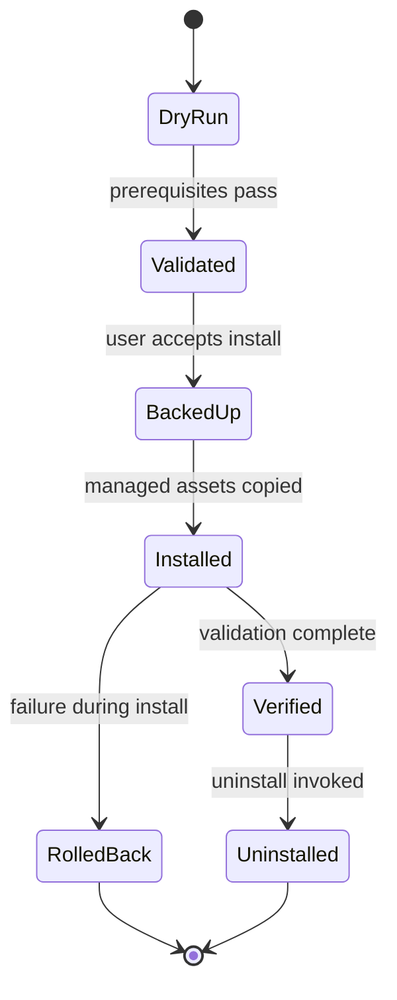

# Architecture

## Design principles

- Public safe templates only
- Manifest driven configuration
- Idempotent installation
- Focused defaults with explicit opt out for network research tools
- Backup and rollback before mutation
- Standard Markdown for durable project context
- Evidence before runtime or topology complexity

## Visual map

The animation progressively reveals the host surfaces, acceptance contract, bounded execution loop, disposable workers, context sources, and verification boundary. Open the [editable static SVG](assets/assured-arc-architecture.svg) for a motion-free version. The diagrams and ownership table below remain the precise structural reference. [Graph and Agent Alignment](GRAPH_ALIGNMENT.md) explains how the design maps to graph-agent research and why Agent-Graph is not a default dependency.

## Component relationship

## Daily execution boundary

Delegation depth is one. Workers cannot spawn workers. Remote research is separated from the writer, and the coordinator cannot edit or execute directly.

## Installer state lifecycle

## Configuration ownership

| Component | Source of truth | Installer behavior |
| --- | --- | --- |
| Extensions | `config/extensions.json` | Installs IDs through VS Code command |
| User settings | `config/user-settings.json` | Merges missing keys by default |
| Agents | `.github/agents` | Copies package owned files only |
| Reusable prompts | `.github/prompts` | Copies package owned prompt files into the managed profile |
| Skill routing | `config/skill-registry.json` | Copies the package catalog without replacing the personal catalog |
| Skills | `.github/skills` | Copies package owned folders into the managed profile only |
| Instructions | `.github/instructions` | Copies the two repository neutral global instructions |
| Harness policy | `config/agent-harness.json` | Renders package registry and skill paths into the managed profile |
| Hooks | `.github/hooks` and `hooks` | Renders platform commands and local trace paths into the managed profile |
| Evaluation | `config/harness-evaluation-fixtures.json` and `tests/harness_evaluator.py` | Replays deterministic behavior and regression contracts |
| Vault | `vault-template` | Creates missing files only |
| MCP inventory | `config/mcp-servers.json` | Pins reviewed identities and local versions |
| Windows entry point | `install.ps1` | Delegates to the tested internal PowerShell lifecycle implementation |
| MCP configuration | `mcp/mcp.json.example` | Merges Context7, Sequential Thinking, and arXiv by default and prepares the managed arXiv runtime |
| Copilot CLI MCP configuration | `mcp/copilot-cli.mcp.json.example` | Uses the CLI-native `mcpServers` schema and separately tracked ownership |
| Copilot CLI profile | `~/.copilot` or `COPILOT_HOME` | Explicit opt in for agents, instructions, hooks, skill-directory registration, and MCP |
| Rollback | `<profile-root>/state.json` | Preserves first-run backups across upgrades, removes owned MCP entries, and can restore complete originals |
