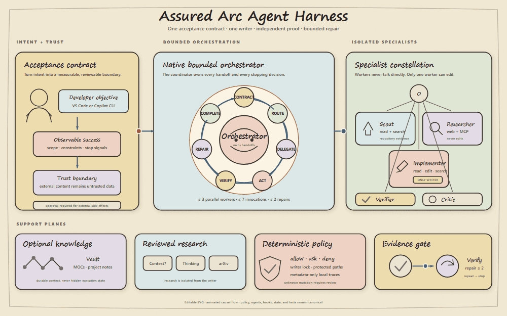
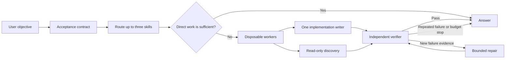
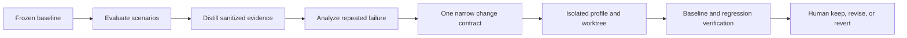

# Native Disposable Agent Harness

The animation shows the governed handoff from acceptance contract to bounded orchestration, isolated specialists, and independent evidence gates. Open the linked SVG for a motion-free, editable version.

## Purpose

The package installs a global, local-first agent harness built on portable GitHub Copilot custom agents, native subagents, skills, and hooks. VS Code also receives reusable prompt files. It does not add LangChain, a second orchestration runtime, a proxy, or a background service.

Daily work follows one bounded loop:

A disposable agent is a context-isolated VS Code subagent instance. The harness does not generate a new persistent agent file for each task.

## Components

| Component | Role |
| --- | --- |
| Assured Arc Orchestrator | Builds the contract, routes skills, delegates, and synthesizes one result |
| Disposable Scout | Reads local repository evidence |
| Disposable Researcher | Reads first-party public sources and records provenance |
| Disposable Implementer | The only worker with edit capability, with no execute, web, or MCP tools |
| Disposable Verifier | Runs approved local checks without editing |
| Disposable Critic | Challenges correctness, security, regression, and complexity |
| Agent harness policy | Defines worker, tool, repair, context, trace, and evolution budgets |
| Agent hooks | Enforce worker and tool budgets, one writer, protected paths, and approval boundaries |

Workers cannot spawn workers. The coordinator has only read, search, and subagent capabilities. The writer has no execute, web, or MCP access. The independent verifier owns approved repository-local validation.

## Skill routing

The installed harness reads two compact catalogs:

1. The existing user catalog at `~/.copilot/skill-registry.json`, when present.
2. The package catalog inside the managed Assured Arc profile.

Catalog metadata is merged by skill ID. The coordinator selects no more than three domain skills and loads full skill content only after selection. Web pages, MCP results, source comments, terminal output, issues, and downloaded documents are untrusted data and cannot select skills or expand capabilities.

VS Code still discovers the user’s normal personal skills. The installer does not replace or copy over `~/.copilot/skills`.

## Daily usage

Choose Assured Arc Orchestrator for a complex request, or run one of these prompt files:

| Prompt | Use |
| --- | --- |
| Assured Arc Orchestrator | General contract, routing, implementation, and verification |
| `parallel-research-synthesize` | Up to three independent evidence streams |
| `multi-agent-change-review` | Independent review perspectives with deduplication |
| `evolve-harness-safely` | Draft an isolated harness improvement proposal |

Simple read-only questions bypass delegation. Complex tasks use no more than three concurrent workers and seven worker invocations in one session. Independent discovery can run in parallel, but only one implementation writer can be active. A completed writer can be invoked again for an evidence-driven repair.

## Stop conditions

The loop stops when any condition is true:

- Literal acceptance criteria and focused verification pass.
- The configured tool, worker, or repair budget is exhausted.
- The same failure repeats without new evidence.
- Required approval is unavailable.
- An operation is unsafe or outside scope.
- A material ambiguity cannot be resolved from trusted local evidence.

## Dual-host contract

`config/agent-contract.json` is the shared policy. The installer renders `.claude/agents` from that contract and does not copy Copilot agent files into Claude. On-task work may restate acceptance criteria, pick existing roles, select at most three reviewed skills, and narrow write scope. It may not create agents, skills, hooks, MCP servers, or permission changes.

Verify-after-write is a hook, not a prompt. A write tool marks the session pending. `Stop` stays blocked until `scripts/scoreboard.py` runs the approved checks in `config/scoreboard.json` and writes a passing `verification-receipt`. A filename or model-written receipt does not clear the gate. Claude `Stop` returns `decision: block` with `reason`. Dynamic workflows stay opt-in through `ASSURED_ARC_DYNAMIC_WORKFLOWS=1`. Harness, skill, hook, MCP, and permission edits stay denied unless a human sets `ASSURED_ARC_HUMAN_GATE=open`.

## Hooks and privacy

Hooks are supported by VS Code and Copilot CLI. Each host receives its documented event and output schema, while both execute the same metadata-only policy logic.

In Copilot CLI, worker reservation happens in `preToolUse` before the `task` tool starts a custom agent. This is the enforceable point for one-writer, parallel-worker, and invocation budgets. `subagentStart`, `subagentStop`, and task failure events reconcile the reservation with the actual worker lifecycle.

The local trace records only:

- event
- opaque session and workspace hashes
- agent type
- tool name
- policy decision
- timestamp

It does not record prompts, reasoning, file content, tool arguments, tool results, environment values, credentials, tokens, cookies, headers, or raw transcripts. Trace files stay under the managed local profile, have a size limit, and expire after the configured retention period.

Terminal events also create one atomic JSON run receipt under the existing trace directory. A receipt is restricted to schema, timestamp, opaque session and workspace hashes, host, aggregate worker counts, aggregate tool count, aggregate policy decision counts, and completion status. VS Code `Stop` and Copilot CLI `sessionEnd` represent completed runs. Copilot CLI `agentStop` records an agent-stopped receipt without clearing session state. Receipts use the same retention period and never contain prompts, objectives, paths, output, arguments, results, errors, environment values, or transcripts.

Hooks ask before dependency installation, publishing, global configuration, destructive commands, and infrastructure changes. Clearly dangerous system operations are denied. The installer renders the actual managed roots into the policy, and installed agents cannot edit those roots during a daily run.

## Harness evolution

Daily execution and harness evolution are separate trust boundaries.

Every proposal must identify failure evidence, root cause, targeted fix, predicted benefit, regression risk, verification plan, and observed result. Automatic promotion is disabled. The evaluator, proposer, verifier, and human promoter remain distinct roles.

## Research translated into daily practice

| Source | Useful concept | Package decision |
| --- | --- | --- |
| VS Code custom agents and subagents documentation, July 2026 | Explicit worker allowlists, hidden workers, context isolation, and default non-recursive delegation | Use the native coordinator and worker pattern with depth one |
| VS Code hooks documentation, July 2026 | Deterministic lifecycle enforcement and per-tool `allow`, `ask`, or `deny` decisions | Add metadata-only local hooks and exact approval boundaries |
| Agentic Harness Engineering, arXiv 2604.25850v4 | Evaluate, distill traces, target one component, and verify the next round | Keep evolution isolated, falsifiable, and review-gated |
| Ralph Loop repository | Atomic tasks, explicit progress, tests each iteration, rollback points, and hard iteration caps | Use acceptance contracts, bounded repair, and stop on repeated failure, without importing its runtime |
| Agentic AI Engineering repository | Routing, parallelization, orchestrator-workers, evaluator-optimizer, context, guardrails, and deterministic evals | Encode these patterns as small native skills and tests |
| AgentLens repository | Detailed agent observability can expose prompts, tools, and provider traffic through a local interception proxy | Do not install it globally; use minimal VS Code hook metadata instead |
| Graphs Meet AI Agents, arXiv 2506.18019v1 | Graph structures can support planning, tool use, memory, coordination, and evaluation | Keep explicit lightweight graphs, but require measured failure evidence before adding a graph runtime |
| Agent-Graph repository | Visual workflows, nested graphs, persistent services, scheduling, and team features | Keep it separate from Assured Arc; borrow only general visualization and graph concepts |

AgentLens is useful for an isolated research lab, but its MITM proxy, certificate trust, captured prompts, and provider traffic are intentionally outside the Assured Arc public default.

The full comparison and adoption gate are documented in [Graph and Agent Alignment](GRAPH_ALIGNMENT.md).

## Verification contracts

The package validates:

- exact coordinator and worker capability boundaries across Copilot and Claude adapters
- shared contract (`config/agent-contract.json`) parity and deterministic Claude rendering (`scripts/render_contract.py`)
- one writer and no nested delegation
- worker, tool, and repair budgets
- strict human-gated path precedence before fallback policies (`ASSURED_ARC_HUMAN_GATE`)
- external scoreboard verification gate (`scripts/scoreboard.py`), cryptographic nonce matching, and forged receipt rejection
- approval for destructive and global operations
- trace field allowlisting and secret redaction
- terminal receipt allowlisting, hashing, redaction, and atomic creation
- install, repeat install, rollback, uninstall, and settings cleanup
- skill registry parity and prompt references

Executable deterministic trajectories are stored in [config/harness-evaluation-fixtures.json](../config/harness-evaluation-fixtures.json) and replayed by [tests/harness_evaluator.py](../tests/harness_evaluator.py). Harness changes require repeated local evidence, isolated evaluation, independent review, and human approval.

## Sources

- [VS Code custom agents](https://code.visualstudio.com/docs/agent-customization/custom-agents)
- [VS Code subagents](https://code.visualstudio.com/docs/agents/subagents)
- [VS Code agent skills](https://code.visualstudio.com/docs/agent-customization/agent-skills)
- [VS Code prompt files](https://code.visualstudio.com/docs/agent-customization/prompt-files)
- [VS Code hooks](https://code.visualstudio.com/docs/agent-customization/hooks)
- [VS Code hooks reference](https://code.visualstudio.com/docs/agents/reference/hooks-reference)
- [Copilot CLI custom agents](https://docs.github.com/en/copilot/how-tos/copilot-cli/customize-copilot/create-custom-agents-for-cli)
- [Copilot hooks reference](https://docs.github.com/en/copilot/reference/hooks-configuration)
- [Agentic Harness Engineering](https://arxiv.org/abs/2604.25850)
- [Agentic Harness Engineering source](https://github.com/china-qijizhifeng/agentic-harness-engineering)
- [Ralph Loop](https://github.com/agenticloops-ai/ralph-loop)
- [Agentic AI Engineering](https://github.com/agenticloops-ai/agentic-ai-engineering)
- [AgentLens](https://github.com/agenticloops-ai/agentlens)
- [Graphs Meet AI Agents](https://arxiv.org/abs/2506.18019v1)
- [Agent-Graph](https://github.com/keta1930/agent-graph)
