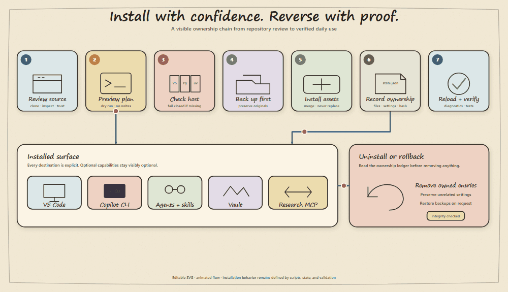

# Installation Guide

## Prerequisites

| Platform | Required | Optional |
| --- | --- | --- |
| Windows | VS Code, PowerShell, Node.js 18+ with npx, uv with Python 3.11+ | Copilot CLI for personal CLI installation, Obsidian for vault visuals |
| macOS | VS Code, Bash, Python 3, Node.js 18+ with npx, uv with Python 3.11+ | Copilot CLI, Obsidian |
| Linux | VS Code, Bash, Python 3, Node.js 18+ with npx, uv with Python 3.11+ | Copilot CLI, Obsidian |

The installer needs the `code` command only when extension installation is enabled. You can install agents, skills, instructions, MCP tools, and the vault template with extensions skipped.

## Safe first run

1. Clone the repository.
2. Run dry run.
3. Inspect extensions, paths, the three research MCP servers, and vault location.
4. Run the real installer.
5. Restart VS Code.
6. Confirm Assured Arc agents, reusable prompts, skills, and hook configuration are visible in Chat customization diagnostics.

Repository agents and skills are automatically available to Copilot CLI when it runs in this repository. Add `-InstallCopilotCli` or `--install-copilot-cli` only when Assured Arc should be available across all repositories in the personal CLI profile.

[](assets/assured-arc-installation-flow.svg)

The diagram summarizes the reversible lifecycle. The scripts, manifests, state file, and validation suite remain the source of truth.

The default managed customization root is `~/.assured-arc/copilot`. VS Code settings point to its agents, prompts, skills, instructions, and hook file. Existing personal skills under `~/.copilot/skills` remain available through normal VS Code discovery and are not overwritten.

## Windows example

```powershell
.\install.ps1 -DryRun
.\install.ps1 -VaultPath "$HOME\Documents\Development Vault"
.\install.ps1 -InstallCopilotCli
```

## macOS or Linux example

```bash
bash install/assured-arc.sh --dry-run
bash install/assured-arc.sh --vault-path "$HOME/Development Vault"
bash install/assured-arc.sh --install-copilot-cli
```

## Isolated testing or team automation

Use isolated paths to test without touching a real profile.

```powershell
.\install.ps1 `
  -SkipMcp `
  -SkipExtensions `
  -ProfileRoot "$env:TEMP\assured-arc-profile" `
  -VsCodeUserDirectory "$env:TEMP\assured-arc-vscode-user" `
  -CopilotRoot "$env:TEMP\assured-arc-copilot"
```

```bash
bash install/assured-arc.sh \
  --skip-mcp \
  --skip-extensions \
  --profile-root /tmp/assured-arc-profile \
  --vscode-user-dir /tmp/assured-arc-vscode-user \
  --copilot-root /tmp/assured-arc-copilot
```

## Default MCP profile

The installer configures Context7, Sequential Thinking, and arXiv by default for VS Code. When personal CLI installation is selected, the same reviewed servers are merged into `~/.copilot/mcp-config.json` with separate ownership. Review both templates and [MCP.md](MCP.md).

## Native harness and hooks

The installer enables native custom agent subagents, keeps nested subagents disabled, and registers the package customization locations. It renders the hook file with absolute local paths so no shell script needs a personal path in the public repository.

Hooks enforce worker and tool budgets, one writer, immutable installed harness paths, and approval for destructive or global operations. VS Code and Copilot CLI use different hook configuration schemas, rendered into the same PowerShell and Python policy implementations. Local traces contain metadata only.

Copilot CLI’s `subagentStart` event cannot block creation, so CLI worker budgets and one-writer enforcement run before delegation through the `task` tool’s `preToolUse` event. The later subagent events reconcile and release worker state.

After installation, run **Chat: Open Customizations** or open Chat diagnostics and confirm:

1. Assured Arc Orchestrator is visible.
2. Disposable workers are hidden but load without errors.
3. The seven package prompts appear in the slash menu.
4. Package skills appear alongside existing personal skills.
5. The package hook file is loaded from the managed profile.

For Copilot CLI, restart the CLI and verify `copilot --agent assured-arc-orchestrator`, `copilot skill list`, and `copilot mcp list`.

## Upgrade

Pull the latest repository version and rerun the installer. Managed files are overwritten only within package owned paths. Existing VS Code settings are merged unless forced.

For a profile created before the Assured Arc rebrand, run the uninstall script from the matching installed version, or pass the exact prior profile root explicitly. Then install Assured Arc into `~/.assured-arc`. Do not copy or move the prior state file.

The installer does not migrate one state profile to a different MCP ownership target. Uninstall the existing profile first when relocating an MCP configuration.

## Removal

Use the uninstall script. Dry run first. Default uninstall removes package customizations and only their exact discovery entries from VS Code settings. Restore settings backups only when you explicitly need the complete pre-install configuration returned.
