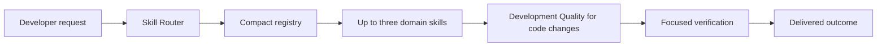

# Skills

Skills are portable, lazy-loaded workflows. The compact [skill registry](../config/skill-registry.json) lets an agent classify a request without loading every skill into its context.

## Context-efficient routing

The router prefers one specific skill over several broad skills. It can merge the existing personal catalog with the package catalog under the managed profile. Repository instructions, source code, and tests remain the primary context.

## Core skills

### Assured Arc Skill Router

**Capability:** classifies nontrivial work and selects the smallest relevant skill set. **Application:** cross-domain or ambiguous tasks. **Prerequisites:** at least one compact catalog listed by the installed harness policy. **Benefit:** lower token use, fewer conflicting instructions, and more specific output.

### Assured Arc Development Quality

**Capability:** applies explicit assumptions, minimum viable design, surgical changes, and focused verification. **Application:** every code-changing task. **Prerequisites:** source code and an appropriate validation command. **Benefit:** smaller diffs, fewer regressions, and clearer evidence.

### Assured Arc Repository Onboarding

**Capability:** guides dry run, customization, installation, validation, and rollback. **Application:** new machines and project onboarding. **Prerequisites:** VS Code and an available shell. **Benefit:** repeatable setup without overwriting existing configuration.

### Assured Arc Task Planning

**Capability:** decomposes multi-step outcomes into dependencies, checkpoints, owners, and observable completion criteria. **Application:** complex features, migrations, and coordinated agent work. **Prerequisites:** a requested outcome and repository context. **Benefit:** less duplicated work, clearer sequencing, and earlier risk discovery.

### Assured Arc Agent Orchestration

**Capability:** composes native context isolated workers with explicit briefs, parallel read only discovery, one writer, independent verification, and bounded repair. **Application:** complex implementation, research, and review tasks. **Prerequisites:** native GitHub Copilot subagents in VS Code or Copilot CLI and the installed harness policy. **Benefit:** smaller parent context, lower coordination risk, and faster independent discovery.

### Assured Arc Context Efficiency

**Capability:** applies progressive disclosure, lazy skill and tool loading, stable prompt prefixes, trajectory pruning, and compaction invariants. **Application:** long or tool heavy sessions. **Prerequisites:** an explicit objective and structured working state. **Benefit:** fewer repeated input tokens and later context exhaustion.

## Design skill

### Assured Arc Architecture Design

**Capability:** defines actors, boundaries, interfaces, data flow, failure handling, and meaningful tradeoffs. **Application:** new systems and major refactors. **Prerequisites:** repository structure and quality constraints. **Benefit:** reduces expensive implementation rework.

## Implementation skills

### Assured Arc Backend and API

**Capability:** designs request contracts, validation, authorization, persistence, workers, and safe failures. **Application:** APIs, services, webhooks, and jobs. **Prerequisites:** framework and data conventions. **Benefit:** stable contracts and fewer boundary defects.

### Assured Arc Frontend and Accessibility

**Capability:** builds responsive, semantic, keyboard-accessible interfaces and interaction states. **Application:** components, forms, dashboards, and navigation. **Prerequisites:** frontend stack and design conventions. **Benefit:** fewer usability defects and broader user support.

### Assured Arc Python Quality

**Capability:** applies environment-aware Python structure, typing, resource handling, testing, and packaging. **Application:** scripts, CLIs, APIs, packages, and automation. **Prerequisites:** selected Python environment and repository tooling. **Benefit:** portable and diagnosable Python without imposing a new toolchain.

### Assured Arc Data and SQL

**Capability:** designs constraints, indexes, queries, migrations, and data-quality checks. **Application:** relational schemas, reports, ETL, and migration work. **Prerequisites:** database engine, schema, workload, and migration process. **Benefit:** fewer slow queries, inconsistent records, and deployment failures.

### Assured Arc Configuration Management

**Capability:** defines typed settings, precedence, validation, safe defaults, environment overrides, and merge behavior. **Application:** application configuration, feature flags, installers, and deployment profiles. **Prerequisites:** configuration consumers and supported environments. **Benefit:** fewer environment-specific failures and safer upgrades.

## Quality skills

### Assured Arc Debugging

**Capability:** reproduces failures, compares hypotheses, instruments boundaries, and fixes confirmed root causes. **Application:** crashes, regressions, flaky tests, and unexpected performance. **Prerequisites:** failure signal and code access. **Benefit:** less trial-and-error editing and fewer symptom-only fixes.

### Assured Arc Testing

**Capability:** chooses unit, integration, end-to-end, regression, and lifecycle tests according to risk. **Application:** implementation verification and bug prevention. **Prerequisites:** existing test framework or a lightweight validation path. **Benefit:** strong confidence with proportional runtime and maintenance.

### Assured Arc Code Review

**Capability:** reviews diffs for correctness, regression, security, maintainability, and unnecessary complexity. **Application:** pull requests and patches. **Prerequisites:** diff, originating request, and repository rules. **Benefit:** actionable findings without style-only noise.

### Assured Arc Performance and Reliability

**Capability:** measures and improves latency, throughput, memory, concurrency, timeouts, retries, and resilience. **Application:** measured bottlenecks and operational failures. **Prerequisites:** baseline, target, and representative workload. **Benefit:** evidence-based improvement without premature optimization.

### Assured Arc Security and Privacy

**Capability:** applies trust boundaries, least privilege, authorization, secret safety, and privacy-aware data flow. **Application:** authentication, uploads, webhooks, installers, telemetry, and data exports. **Prerequisites:** data classification and deployment context. **Benefit:** fewer common security defects and information leaks.

### Assured Arc Error Handling

**Capability:** designs stable error contracts, cleanup, partial failure behavior, retry boundaries, and graceful degradation. **Application:** APIs, jobs, installers, and integration code. **Prerequisites:** realistic failure modes and caller expectations. **Benefit:** more predictable recovery and easier diagnosis.

### Assured Arc Observability

**Capability:** designs structured logs, metrics, traces, health checks, audit events, and actionable diagnostics. **Application:** services, jobs, CLIs, and production troubleshooting. **Prerequisites:** operational questions and data-handling constraints. **Benefit:** faster incident diagnosis without logging sensitive data.

### Assured Arc Agent Evaluation

**Capability:** validates loop termination, capability boundaries, tool history, safety approvals, output quality, privacy, and regression behavior with mocked or deterministic scenarios. **Application:** changes to agents, prompts, skills, hooks, or routing. **Prerequisites:** an acceptance contract and scenario catalog. **Benefit:** reproducible agent changes without relying on self assessment.

### Ponytail

**Capability:** challenges unnecessary code and prefers deletion, standard libraries, platform features, and one direct implementation. **Application:** explicit requests for minimal code, YAGNI, or overengineering review. **Prerequisites:** clear success criteria. **Benefit:** less code, fewer dependencies, and lower maintenance cost. It remains lazy loaded because Development Quality already supplies ordinary simplicity guidance.

## Delivery skills

### Assured Arc Git and CI

**Capability:** creates focused source-control workflows, least-privilege CI, release checks, and deployment gates. **Application:** pull requests, GitHub Actions, and releases. **Prerequisites:** repository host and validation commands. **Benefit:** faster feedback and fewer integration failures.

### Assured Arc Dependency Evaluation

**Capability:** evaluates necessity, source, license, maintenance, permissions, compatibility, and rollback for third-party software. **Application:** packages, extensions, actions, community skills, and MCP servers. **Prerequisites:** primary source and project constraints. **Benefit:** lower supply-chain risk and dependency bloat.

### Assured Arc Documentation Quality

**Capability:** produces task-oriented, source-grounded README files, tutorials, runbooks, and architecture docs. **Application:** onboarding and operational guidance. **Prerequisites:** implemented behavior and target audience. **Benefit:** lower onboarding time and support load.

## Platform skills

### Assured Arc Web Research

**Capability:** guides live web search, primary URL fetching, citation tracking, and prompt-injection quarantine. **Application:** looking up current documentation, release notes, upstream repositories, and security advisories when local context is insufficient. **Prerequisites:** host web search/fetch tools (`web`, `WebSearch`, `WebFetch`) or reviewed research MCP servers (`context7`, `arxiv`). **Benefit:** accurate online discovery with verifiable provenance while keeping untrusted web content isolated from the single implementation writer.

### Assured Arc MCP Safety

**Capability:** reviews MCP transport, endpoints, scope, authentication, secrets, and rollback. **Application:** enabling or adopting MCP servers. **Prerequisites:** server runtime and documented auth. **Benefit:** live tools with reduced filesystem, network, and credential exposure.

### Assured Arc Obsidian Vault

**Capability:** manages Markdown project memory, MOCs, templates, and local-only privacy boundaries. **Application:** durable project context and engineering decisions. **Prerequisites:** none for Markdown; Obsidian is optional. **Benefit:** context that outlives chat sessions.

### Assured Arc Harness Evolution

**Capability:** evaluates repeated failures, targets one harness component, tests a falsifiable change in an isolated profile and worktree, and produces a keep, revise, or revert recommendation. **Application:** explicit agent harness improvement work only. **Prerequisites:** repeated sanitized evidence, regression scenarios, independent review, and human approval. **Benefit:** auditable improvement without uncontrolled production self modification.

Do not use skills as permanent global prompt content. Route first, then load only the selected skills.